  <picture><source media="(prefers-color-scheme: dark)" srcset="./assets/header-dark.svg" /><source media="(prefers-color-scheme: light)" srcset="./assets/header-light.svg" /></picture>

  
  
  
  
  
  
  
  

<picture><source media="(prefers-color-scheme: dark)" srcset="./assets/title-about-dark.svg" /><source media="(prefers-color-scheme: light)" srcset="./assets/title-about-light.svg" /></picture>

I’m Priyansu Pattanaik, an AI Engineer building LLM-powered products, RAG systems, and multi-agent AI experiences.

- **Focus:** LLMs, RAG, AI agents, and multi-agent systems
- **Open to:** full-time and freelance work
- **Reach me:** [priyansupattanaikwork@gmail.com](mailto:priyansupattanaikwork@gmail.com)

<picture><source media="(prefers-color-scheme: dark)" srcset="./assets/title-work-dark.svg" /><source media="(prefers-color-scheme: light)" srcset="./assets/title-work-light.svg" /></picture>

  <a href="https://github.com/priyansupattanaik/career-copilot"><picture><source media="(prefers-color-scheme: dark)" srcset="./assets/card-career-copilot-dark.svg" /><source media="(prefers-color-scheme: light)" srcset="./assets/card-career-copilot-light.svg" /></picture></a>
  <a href="https://github.com/priyansupattanaik/visionguard-VideoRAG"><picture><source media="(prefers-color-scheme: dark)" srcset="./assets/card-visionguard-dark.svg" /><source media="(prefers-color-scheme: light)" srcset="./assets/card-visionguard-light.svg" /></picture></a>

  <a href="https://github.com/priyansupattanaik/promptLAB"><picture><source media="(prefers-color-scheme: dark)" srcset="./assets/card-promptlab-dark.svg" /><source media="(prefers-color-scheme: light)" srcset="./assets/card-promptlab-light.svg" /></picture></a>
  <a href="https://github.com/priyansupattanaik/aegis-node"><picture><source media="(prefers-color-scheme: dark)" srcset="./assets/card-aegis-node-dark.svg" /><source media="(prefers-color-scheme: light)" srcset="./assets/card-aegis-node-light.svg" /></picture></a>

  <a href="https://github.com/priyansupattanaik/resuscanner.ai"><picture><source media="(prefers-color-scheme: dark)" srcset="./assets/card-resuscanner-dark.svg" /><source media="(prefers-color-scheme: light)" srcset="./assets/card-resuscanner-light.svg" /></picture></a>
  <a href="https://github.com/priyansupattanaik/ux-psych-design"><picture><source media="(prefers-color-scheme: dark)" srcset="./assets/card-ux-psych-design-dark.svg" /><source media="(prefers-color-scheme: light)" srcset="./assets/card-ux-psych-design-light.svg" /></picture></a>

Live: <a href="https://careercopilotai.vercel.app/">Career Copilot</a> · <a href="https://npm-aegisnode.vercel.app">AegisNode CLI</a> · <a href="https://resuscanner.netlify.app/">ResuScanner.AI</a> · <a href="https://github.com/priyansupattanaik?tab=repositories">All repositories →</a>

<picture><source media="(prefers-color-scheme: dark)" srcset="./assets/title-stack-dark.svg" /><source media="(prefers-color-scheme: light)" srcset="./assets/title-stack-light.svg" /></picture>

  <picture><source media="(prefers-color-scheme: dark)" srcset="https://skillicons.dev/icons?i=python%2Cjs%2Cts%2Cjava%2Cpytorch%2Ctensorflow%2Copencv%2Csklearn%2Cfastapi%2Cflask%2Cnodejs%2Cpostgres%2Cmysql%2Cmongodb%2Creact%2Cnextjs%2Ctailwind%2Cgit%2Cdocker%2Caws%2Clinux%2Cpostman%2Cgithubactions&perline=12&theme=dark" /><source media="(prefers-color-scheme: light)" srcset="https://skillicons.dev/icons?i=python%2Cjs%2Cts%2Cjava%2Cpytorch%2Ctensorflow%2Copencv%2Csklearn%2Cfastapi%2Cflask%2Cnodejs%2Cpostgres%2Cmysql%2Cmongodb%2Creact%2Cnextjs%2Ctailwind%2Cgit%2Cdocker%2Caws%2Clinux%2Cpostman%2Cgithubactions&perline=12&theme=light" /></picture>

  <picture><source media="(prefers-color-scheme: dark)" srcset="./assets/stack-dark.svg" /><source media="(prefers-color-scheme: light)" srcset="./assets/stack-light.svg" /></picture>

<picture><source media="(prefers-color-scheme: dark)" srcset="./assets/title-journey-dark.svg" /><source media="(prefers-color-scheme: light)" srcset="./assets/title-journey-light.svg" /></picture>

  <picture><source media="(prefers-color-scheme: dark)" srcset="./assets/journey-dark.svg" /><source media="(prefers-color-scheme: light)" srcset="./assets/journey-light.svg" /></picture>

<b>Full Stack Developer Intern · Indoplus</b> · Aug 2024 – Apr 2025

- Built an internal HRMS for employee management, attendance tracking, salary allocation, reports, dashboards, authentication, and RBAC using React, Node.js, and SQL.
- Developed MyJob, a React Native recruitment app with a React/Node.js web dashboard and SQL backend for recruiters and job seekers.
- Added OpenAI-based chatbot and job-description parsing features to support recruitment workflows.
- Deployed production components on AWS.

<picture><source media="(prefers-color-scheme: dark)" srcset="./assets/title-activity-dark.svg" /><source media="(prefers-color-scheme: light)" srcset="./assets/title-activity-light.svg" /></picture>

  <picture><source media="(prefers-color-scheme: dark)" srcset="https://github-readme-stats.vercel.app/api?username=priyansupattanaik&show_icons=true&hide_border=true&bg_color=00000000&rank_icon=github&title_color=59AAF8&icon_color=59AAF8&text_color=A5A9B1" /><source media="(prefers-color-scheme: light)" srcset="https://github-readme-stats.vercel.app/api?username=priyansupattanaik&show_icons=true&hide_border=true&bg_color=00000000&rank_icon=github&title_color=0B66D6&icon_color=0B66D6&text_color=545860" /></picture>
  <picture><source media="(prefers-color-scheme: dark)" srcset="https://github-readme-stats.vercel.app/api/top-langs/?username=priyansupattanaik&layout=compact&hide_border=true&bg_color=00000000&title_color=59AAF8&text_color=A5A9B1&langs_count=8" /><source media="(prefers-color-scheme: light)" srcset="https://github-readme-stats.vercel.app/api/top-langs/?username=priyansupattanaik&layout=compact&hide_border=true&bg_color=00000000&title_color=0B66D6&text_color=545860&langs_count=8" /></picture>

  <picture><source media="(prefers-color-scheme: dark)" srcset="https://streak-stats.demolab.com/?user=priyansupattanaik&hide_border=true&background=00000000&ring=59AAF8&fire=59AAF8&currStreakNum=F4F5F7&sideNums=F4F5F7&currStreakLabel=59AAF8&sideLabels=A5A9B1&dates=888C94&stroke=222428" /><source media="(prefers-color-scheme: light)" srcset="https://streak-stats.demolab.com/?user=priyansupattanaik&hide_border=true&background=00000000&ring=0B66D6&fire=0B66D6&currStreakNum=101215&sideNums=101215&currStreakLabel=0B66D6&sideLabels=545860&dates=6A6F77&stroke=DDE0E4" /></picture>

  <picture><source media="(prefers-color-scheme: dark)" srcset="https://raw.githubusercontent.com/priyansupattanaik/priyansupattanaik/output/github-snake-dark.svg" /><source media="(prefers-color-scheme: light)" srcset="https://raw.githubusercontent.com/priyansupattanaik/priyansupattanaik/output/github-snake.svg" /></picture>

  <picture><source media="(prefers-color-scheme: dark)" srcset="./assets/footer-dark.svg" /><source media="(prefers-color-scheme: light)" srcset="./assets/footer-light.svg" /></picture>

